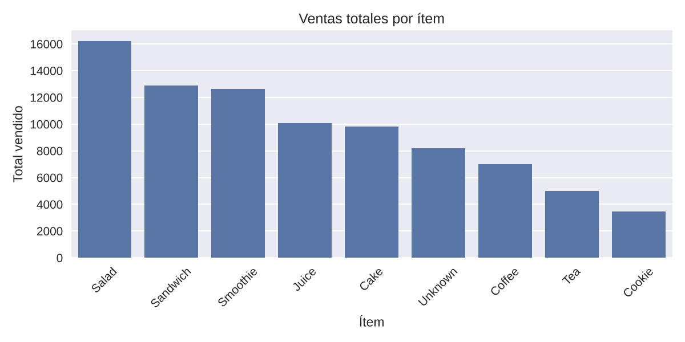

# Limpieza y análisis exploratorio de ventas de una cafetería

> **English summary.** Data cleaning and exploratory analysis of a deliberately dirty café sales dataset (10,000 transactions, 2023). The cleaning notebook normalises columns, handles invalid markers ("ERROR", "UNKNOWN"), fixes types and dates, and rebuilds the transaction total. After cleaning, 9,540 transactions remain, with total revenue of 85,246.5 and an average ticket of 8.94. About a third of the transactions have no recorded payment method, which limits any conclusion about payment preferences.

Convierte un CSV de ventas con errores de tipo, marcadores inválidos y valores faltantes en un dataset analizable, y describe qué se vende, cuándo y cómo se paga.

## Resultado principal

**De 10.000 transacciones se conservan 9.540 (95,4 %)** tras la limpieza; solo se descartan las 460 que no tienen una fecha válida. Sobre ese dataset, el ingreso total es de 85.246,5 y el ticket medio de 8,94.



- **Productos.** Las unidades vendidas se reparten de forma pareja entre los ocho productos (entre 3.093 y 3.425 cada uno), así que las diferencias de ingreso vienen del precio: Salad aporta el 19,0 % del ingreso, Sandwich el 15,1 % y Smoothie el 14,8 %. Coffee es el producto con más unidades, pero solo aporta el 8,2 %.
- **Meses.** No se observa estacionalidad: el ingreso mensual va de 6.673 (febrero) a 7.418 (junio), un 11 % de diferencia.
- **Métodos de pago.** No hay una preferencia clara: Digital Wallet 23,0 %, Credit Card 22,7 % y Cash 22,6 %. El 31,6 % de las transacciones no tiene método registrado, más que cualquier método individual.
- **Ubicación.** In-store (30,1 %) y Takeaway (30,3 %) están parejos; el 39,6 % no tiene ubicación registrada.

## Dataset

- **Fuente:** [Cafe Sales - Dirty Data for Cleaning Training](https://www.kaggle.com/datasets/ahmedmohamed2003/cafe-sales-dirty-data-for-cleaning-training), en Kaggle. Es un dataset sintético creado para practicar limpieza de datos.
- **Tamaño:** 10.000 filas y 8 columnas (`Transaction ID`, `Item`, `Quantity`, `Price Per Unit`, `Total Spent`, `Payment Method`, `Location`, `Transaction Date`); 528 KB.
- Está incluido en `data/dirty_cafe_sales.csv`. Los montos no declaran moneda.

## Cómo reproducirlo

```bash
pip install -r requirements.txt
jupyter nbconvert --to notebook --execute --inplace notebooks/01_data_cleaning.ipynb
jupyter nbconvert --to notebook --execute --inplace notebooks/02_eda.ipynb
```

Probado con Python 3.13.

## Estructura

```
data/
  dirty_cafe_sales.csv       dataset original
  cleaned_cafe_sales.csv     salida del notebook 01
figures/
  ventas_por_item.png        generado por el notebook 02
notebooks/
  01_data_cleaning.ipynb     limpieza
  02_eda.ipynb               análisis exploratorio
requirements.txt
```

## Limitaciones y próximos pasos

- Cantidad y precio faltantes se imputan con la mediana y el total se recalcula a partir de ellos. Es una simplificación: cuando falta uno de los tres valores (cantidad, precio, total) se puede reconstruir de forma exacta con los otros dos, y el precio se puede deducir del producto. Es la mejora pendiente más importante.
- El dataset es sintético: sirve para mostrar el proceso de limpieza, no para sacar conclusiones sobre un negocio real.
- El análisis es descriptivo; no responde una pregunta de negocio concreta ni incluye pruebas automáticas de las reglas de limpieza.

## Stack

Python, pandas, matplotlib y seaborn.
